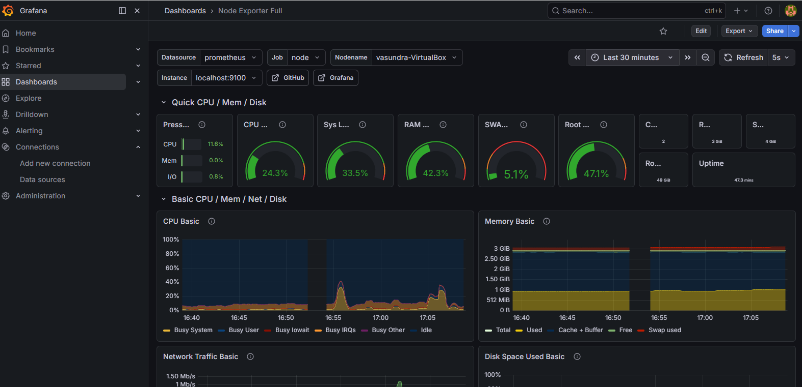
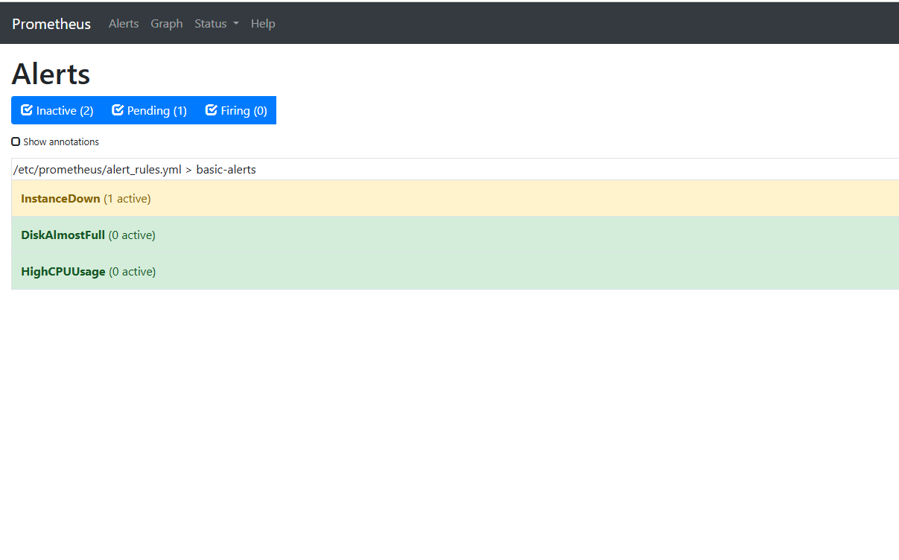

# NOC Monitoring Lab

A hands-on monitoring stack built on an Ubuntu VM (VirtualBox) to practise NOC engineer skills.

## Stack
- **node_exporter:** exposes Linux server metrics
- **Prometheus:** scrapes and stores metrics, evaluates alert rules
- **Alertmanager:** sends email notifications for firing and resolved alerts
- **Grafana:** dashboards (Node Exporter Full, ID 1860)

## Alert rules
- `InstanceDown`: target unreachable for 1 minute (critical)
- `HighCPUUsage`: CPU above 80% for 2 minutes (warning)
- `DiskAlmostFull`: less than 10% free space on `/` (warning)

## How I tested it
1. Stopped node_exporter, so `InstanceDown` went Pending and then Firing
2. Received the FIRING email from Alertmanager
3. Restarted node_exporter and received the RESOLVED email

## Setup
1. Install: `sudo apt install prometheus prometheus-node-exporter prometheus-alertmanager`
2. Copy the files from `prometheus/` and `alertmanager/` to `/etc/prometheus/`
3. Add your Gmail App Password to `alertmanager.yml` (placeholder in this repo)
4. Validate: `promtool check config /etc/prometheus/prometheus.yml` and `amtool check-config /etc/prometheus/alertmanager.yml`
5. Restart the services with `sudo systemctl restart prometheus prometheus-alertmanager`

## Screenshots

## What I learned
- The Prometheus pull model and basic PromQL
- Writing alert rules and how `for:` avoids false alarms
- Alertmanager routing and troubleshooting email delivery with logs

